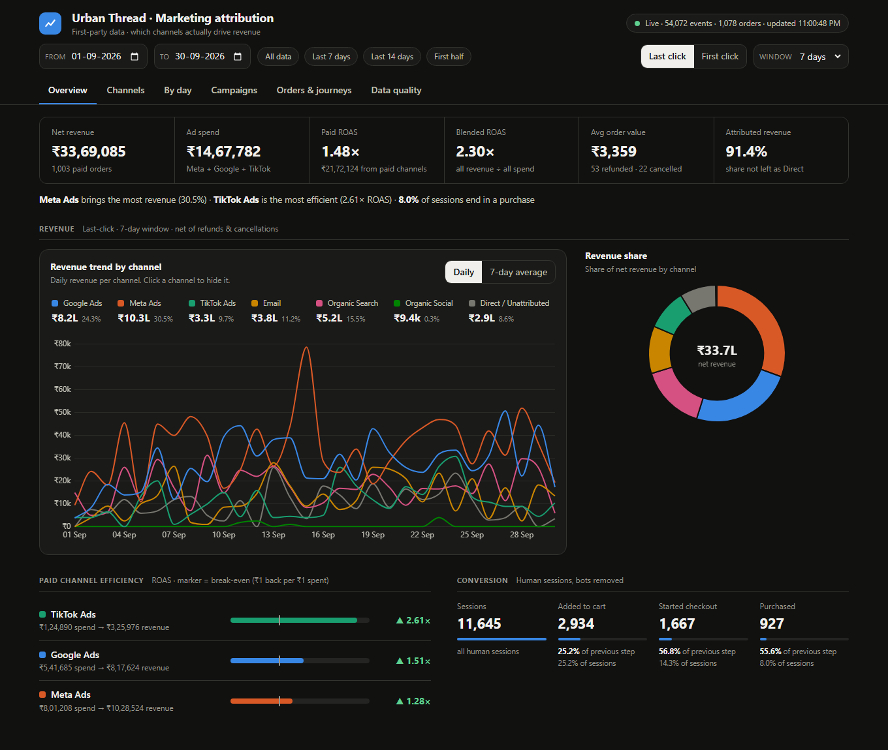

# Urban Thread: first-party attribution pipeline

Collects the store's website events and order webhooks over HTTP, stitches them into visitor
sessions and people, credits every real order to a marketing channel (last click, first click as a
bonus), and serves orders / revenue / ad spend / ROAS per channel through an API and a dashboard.



## Run it

**1. A PostgreSQL database** (14+). Use one you already have, or `docker compose up -d` (see `docker-compose.yml`), then:
```bash
python scripts/setup_db.py       # asks for host / user / password (typed locally), creates the databases
                                 # `urbanthread` + `urbanthread_test`, and writes a git-ignored `.env`
```
(or copy `.env.example` to `.env` and set `DATABASE_URL` yourself).

**2. The service and the data**
```bash
pip install -r requirements.txt
python -m uvicorn app.main:app --port 8000        # service + dashboard on http://localhost:8000
```
The React dashboard ships pre-built in `app/static/app`, so Python is all you need to run it. To change the UI:
`cd frontend && npm ci && npm run dev` (hot reload on :5173, proxied to the API), then `npm run build` to refresh the bundle.
```bash
python sender/send.py --data-dir <folder with events.jsonl, orders.csv, ad_spend.csv>   # replays them over HTTP
```
The Urban Thread dataset is **not included in this repo** (it is the client's data and 25 MB); put the three files in the repo root
and `--data-dir` can be omitted. Open <http://localhost:8000>. The dashboard updates live while the sender runs (about 3.5 min for
September). For the October drop: `python sender/send.py --data-dir <folder with the 3 files>`.
Re-running the sender is always safe (everything is idempotent). Other entry points:

| | |
|---|---|
| `pip install -r requirements-dev.txt` then `python -m pytest -q` | 27 behavioural tests (attribution, windows, late data, refunds, dedupe, FX, ...). They run on a throwaway PostgreSQL: set `TEST_DATABASE_URL` (the database name must contain `test`, because the tests TRUNCATE every table; the suite refuses to run otherwise) |
| `ruff check .` | backend lint (clean) |
| `cd frontend && npm test && npm run typecheck` | frontend unit tests and strict TypeScript check; CI (`.github/workflows/ci.yml`) runs all of it |
| `python scripts/verify.py --data-dir <dir>` | re-computes the headline numbers from the raw files with pandas, **separately from the service**, and diffs them against the API |
| `http://localhost:8000/docs` | interactive API docs |
| `POST /admin/reset` | wipe the database (for a clean demo) |

Python 3.11+. Storage is PostgreSQL via `psycopg` 3 and a connection pool; the schema is created on first start (`app/db.py`).
Timestamps are `TIMESTAMPTZ` (always returned as UTC), days are `DATE`, money is `NUMERIC(14,2)`, flags are `BOOLEAN`.

## API

| Endpoint | Purpose |
|---|---|
| `POST /collect` | one pixel event, or a list of events. Idempotent on `event_id`. |
| `POST /webhooks/orders` | one order webhook, or a list. Newest `updated_at` wins, whatever the arrival order. |
| `POST /ad-spend` | one ad-spend row, or a list. Newest `pulled_at` wins per day and campaign. |
| `GET /api/report?from=&to=&model=&window_days=` | **orders, revenue, ad spend, ROAS per channel** for a date range (+ AOV, CPA, refunds, sessions) |
| `GET /api/daily` / `/api/campaigns` | the same per day (and per channel per day) / per campaign |
| `GET /api/funnel`, `/api/conversion-lag` | sessions to purchase funnel; days from first visit to order |
| `GET /api/orders`, `/api/orders/{id}` | every order with its credited channel; full evidence for one order |
| `GET /api/quality`, `/api/status` | everything excluded or corrected, with counts; pipeline health |

`model` is `last_click` (default) or `first_click`; `window_days` defaults to 7. Dates are UTC.

## Architecture

```
sender ──HTTP──> /collect  /webhooks/orders  /ad-spend          (validate, normalise, store RAW, return 202)
                        │
        raw tables (append-only facts):  events · order_webhooks · ad_spend_pulls
                        │ latest-state tables: orders (newest webhook), ad_spend_current (newest pull)
                        ▼   background worker, debounced after ingest goes quiet
        refresh():  sessions (only for visitors with new events)  →  person graph  →  order attribution
                        ▼
        /api/*  and  dashboard
```
**Principle: store raw facts, derive everything.** Ingestion never computes anything heavy, and every
derived table (`sessions`, `person_map`, `order_attribution`) can be dropped and rebuilt from the raw
tables. That is what makes "new data that changes the past" safe: a late event or a refund simply marks
the affected visitor dirty, and the pipeline re-derives their sessions and re-attributes orders. The
swap-in is one write transaction, so a report never sees half-built tables.

### Frontend (`frontend/`)
React 18 + TypeScript (strict) + Vite + Chart.js. Deliberately small and boring:
- `types.ts` mirrors the API responses, so a backend field rename fails the type-check instead of rendering `NaN`.
- `hooks.ts`: `useApi` aborts in-flight requests when the date range or filters change (a slow answer for an old range can never overwrite a newer one), keeps showing the previous data while refreshing, and surfaces errors; `useStatus` polls `/api/status` and re-fetches only when the backend has *finished* processing, so the dashboard updates live during ingest without flicker.
- One component per tab (`tabs/`), chart components in `charts/`, shared look in `chartKit.ts`; colours come from CSS variables (light/dark follow the OS) and each channel keeps a fixed colour slot regardless of filters.
- Accessibility: WAI-ARIA tabs with arrow-key navigation, labelled controls, `role="img"` + `aria-label` on charts, keyboard-operable order rows, native `<dialog>` for order evidence.

## The decisions that decide the numbers

**Revenue.** `orders.csv` is the source of truth ("what was sold"). An order's state is its
newest webhook by `updated_at` (not by arrival, because webhooks can arrive out of order). Revenue =
orders whose current status is `paid`, booked on the order's `created_at` UTC day. Refunded / cancelled
orders (53 and 22) are never revenue; they are shown in their own columns. So a refund that arrives
in October *does* lower September; that is the correct behaviour, not a bug. Pixel `purchase` events
are never summed (60 are repeats, 15 are `TEST-*`); they are only used to link an order to a browser.

**Currency.** 43 webhooks are USD. Every USD price is exactly INR / 84 (1899 ↔ 22.61, 3999 ↔ 47.61, 8998 ↔ 107.12),
so 84 is the store's own rate. Everything is reported in INR (ad spend is INR too). Never summed mixed.

**Attribution window: 7 days, last non-direct click.**
A touch = a human page view carrying a marketing signal (utm tags, a `gclid`/`fbclid`/`ttclid`, or an external
referrer like Google/Facebook). The order is credited to the **latest touch in the 7×24 h before it**.
Direct visits and on-site navigation are not touches, so a buyer who comes back by typing the URL still credits the ad that
found them. Why 7 days: it matches Meta's default 7-day-click window; our own data supports it (median days from
first visit to paid order is 0.83, and 86% of buyers convert within 7 days, see "Orders & journeys").
No touch inside the window → `Direct / Unattributed`; we do not guess. Window and model are switchable
in the UI/API (the stored default is 7; other windows are computed on demand from the same touches).
First click (earliest touch in the window) is the bonus model.

**Who is the same person.** A person is a connected component of: browser (`anonymous_id`) ↔ `email_hash`
(whenever an event carries both: identify, checkout, purchase), order ↔ `email_hash`, and order ↔ the browser
that fired its purchase pixel. 96 people use more than one device; all their devices' touches can earn credit, and
days-to-convert starts at their first visit on *any* device. 58 paid orders (₹1,07,442, 3.2% of revenue) can't be linked to
any browser, because the email was never seen on the site and there is no purchase pixel. They are reported as
Direct / Unattributed, flagged as `no linked visit` in the order explorer.

**Sessions.** Per browser, a new session after more than 30 minutes of inactivity. A session's channel = its first
marketing touch. Bots are excluded.

### What was wrong in the data, and what I did (all counted live in the dashboard's *Data quality* tab)

| Finding | Count | Decision |
|---|---|---|
| Duplicate `event_id` (pixel retries, later `received_at`, identical content) | 1,686 | dedupe on `event_id`, first delivery kept |
| Bots: HeadlessChrome, python-requests, AhrefsBot | 6,182 events / 25 visitors | stored but excluded from sessions, identity and attribution (none purchased) |
| `ts` in three formats: ISO `Z`, ISO `+05:30`, epoch milliseconds | 7,951 offset / 2,589 epoch | everything normalised to UTC |
| Impossible device clocks (year 2036 / year 2025) | 100 / 45 | event time replaced by server `received_at` (rule: >5 min in the future or >7 days old) |
| Late-arriving events (device time plausible, server saw it 1-3 days later) | 1,020 | kept on device time; sessions and attribution re-derived. This is "data that changes the past". |
| Inconsistent `utm_source` (`google`/`Google`, `fb`/`facebook`/`ig`/`instagram`, `klaviyo`/`newsletter`, ...) | 8 spellings | lower-cased and mapped to channels |
| Landings with a click id but **no** utm tags | 463 | mapped by click id; otherwise paid revenue silently falls into Direct |
| `TEST-*` purchase events | 15 | ignored |
| Orders with several webhooks (paid → refunded / cancelled) | 75 | newest `updated_at` wins; replays/out-of-order can't resurrect revenue |
| Ad-spend rows re-pulled with restated amounts (e.g. 3,385 → 3,845) | 20 | newest `pulled_at` per (day, campaign) wins; older pulls kept for audit |

Judgement calls worth challenging: (1) 84 INR/USD is inferred, not provided; (2) `received_at` is trusted over
device `ts` only when the clock is impossible, not when it is merely late; (3) I attribute by person across devices,
which raises attribution coverage but depends on `email_hash` never being shared between people (no browser had two
emails in this data); (4) `meta_advplus_diwali_teaser` is a campaign running in September, so it is reported like any other.

## Final September numbers (last click, 7-day window, INR)

| Channel | Orders | Revenue | Ad spend | ROAS |
|---|---:|---:|---:|---:|
| Meta Ads | 313 | 10,28,524 | 8,01,208 | 1.28× |
| Google Ads | 224 | 8,17,624 | 5,41,685 | 1.51× |
| Organic Search | 149 | 5,21,515 | – | – |
| Email | 98 | 3,77,772 | – | – |
| TikTok Ads | 103 | 3,25,976 | 1,24,890 | 2.61× |
| Direct / Unattributed | 112 | 2,88,277 | – | – |
| Organic Social | 4 | 9,396 | – | – |
| **Total** | **1,003** | **33,69,085** | **14,67,782** | blended 2.30× · paid 1.48× |

1,078 orders exist; 1,003 are paid, 53 were refunded (₹1,93,428) and 22 cancelled (₹70,074). **Every line of this table is
reproduced by `python scripts/verify.py`** (a separate pandas implementation reading the raw files) to the paisa.
Reading it: TikTok is the most efficient paid channel (2.6×) but the smallest paid channel; Meta takes the most spend at the lowest ROAS; Email and
Organic Search bring ~27% of revenue at zero ad cost, so blended ROAS (2.30×) flatters paid media (1.48×).
Screenshots of every tab are in [`docs/`](docs/).

## SQL questions

[`queries.sql`](queries.sql) (PostgreSQL): (1) sessions and median session length per day; (2) days from a buyer's first
visit on any device to each paid order. It is written against this project's own tables (`psql "$DATABASE_URL" -f queries.sql`).
**Status:** on the earlier SQLite build I validated line-for-line translations against the pipeline (Q1 matched on count and median for all 30 days;
Q2 matched for all 1,003 paid orders, 58 NULL = the unlinkable orders above). After moving to PostgreSQL I have **not yet executed
`queries.sql` itself against a Postgres instance holding the data**; do that before relying on it.

## What works / what doesn't (honest status)

**Storage migration status:** the service was first built and verified end to end on SQLite, then ported to PostgreSQL. After the port, all 27 tests
passed and the full September load completed (57,141 records accepted, about 345 records/s) on a *temporary local PostgreSQL 16*. I have **not** run it
against a PostgreSQL 18 server, and I did not re-run `scripts/verify.py` on the Postgres-backed data; the September table below was verified on the SQLite build with identical logic.

Works: live ingest with 15 concurrent connections (about 290-350 records/s from the sender, so September replays in about 3-3.5 min); idempotent replays; late events,
refunds, out-of-order webhooks and restated spend all re-derive correctly (covered by tests, and demonstrated with a synthetic "October" drop);
dashboard with date filter, model and window switch, order-level evidence.

Limits I know about:
- **Single app process, single Postgres.** Every refresh recomputes identity and attribution globally (~1-2 s at 54k events on SQLite; not re-measured on Postgres). Fine here, not at scale.
- **Reports are computed per request** from derived tables, with no caching or pre-aggregation.
- **Attribution is deterministic rules, not probabilistic.** Ad blockers, cross-device without a login and iOS click loss are invisible; the "Direct" bucket absorbs them.
- **Spend is channel-level only where utm has no campaign** (the *(no campaign tag)* rows have revenue but no spend by definition).
- **Dates are UTC** (the README says so); the store is in IST, so "day" boundaries differ by 5½ h from a local reading.
- There is no auth on the API, and `/admin/*` is open (local demo).
- `queries.sql` has not been run on a Postgres instance with the data loaded (see above). No deployment (Railway) was attempted.

## If this ran for 500 stores at 50 M events/day

~25 B events/day, ~290 k events/s average and several times that at peak. What breaks first, in order:
1. **The write path.** One Python process, a pooled Postgres and a transaction per request tops out at a few hundred events/s (about 345/s measured). Put a
   log in front: pixel → thin stateless edge (Go/Rust or serverless) → Kafka/Redpanda partitioned by `(store_id, anonymous_id)`; stateless consumers write batches. 202 stays a "durably queued" ack. Ids stay the idempotency key.
2. **Storage and queries.** Row store + per-request aggregation falls over at billions of rows. Move raw events to columnar storage (ClickHouse / BigQuery),
   partitioned by store and day, with `ReplacingMergeTree`-style dedupe on `event_id`; keep orders and spend in Postgres (small, relational).
3. **The global refresh.** Rebuilding identity + attribution over everything is O(all data). Make it per-store and per-person: keep the identity graph in a
   keyed store (Redis/Scylla), sessionise in a stream processor (Flink) with a late-event allowed lateness (~3-7 days here), and recompute attribution only for people touched by new events, bounded by the 7-day window (that data fits in memory per person).
4. **Dashboards.** Pre-aggregate by `(store, day, channel)` into materialised rollups, and invalidate only the days a late event touched; serve from the rollup.
5. **Multi-tenancy and hot keys.** `store_id` on every row and key, per-store rate limits and quotas, a bot/crawler filter at the edge (6 of ~56 k events here are bots, but at scale it is a real cost), and reprocessing by replaying the log
   for a store (rebuildability is why raw facts are append-only).
6. **Backfill / correctness at scale.** Daily reconciliation of attributed revenue against the order system, so drift is detected, not discovered.

## How I used AI

I used Claude Code to profile the data, draft the schema/pipeline/dashboard, and write tests; I reviewed the logic and the numbers myself and
verified the headline figures against an independent pandas calculation (`scripts/verify.py`). Where it got something wrong:
- **Wrong result, caught by running it:** my first profile of the data assumed `ts` was always an ISO string and crashed on the 2,666 epoch-millisecond
  values, and I would have mis-classified bots by only matching the substring "bot" (missing HeadlessChrome and python-requests). Both were found by running against the real file, not by reading it.
- **Wrong tests, not wrong code:** three of my first tests asserted a channel row would be *absent* ("no credit") when it also exists from its sessions; the rule was right, the assertion was too naive.
- **My own demo was wrong, and the system was right:** my first "late event" demo arrived 29 days late and had no effect; the pipeline correctly refused to trust such a clock. I re-ran it with a realistic 4-day delay and the order moved from Direct to Google.
- **Performance assumption:** I assumed the server was the throughput bottleneck, but measuring with two parallel senders showed it was the single-process async HTTP client; replacing it with persistent-connection worker threads gave about 2.5× throughput.
